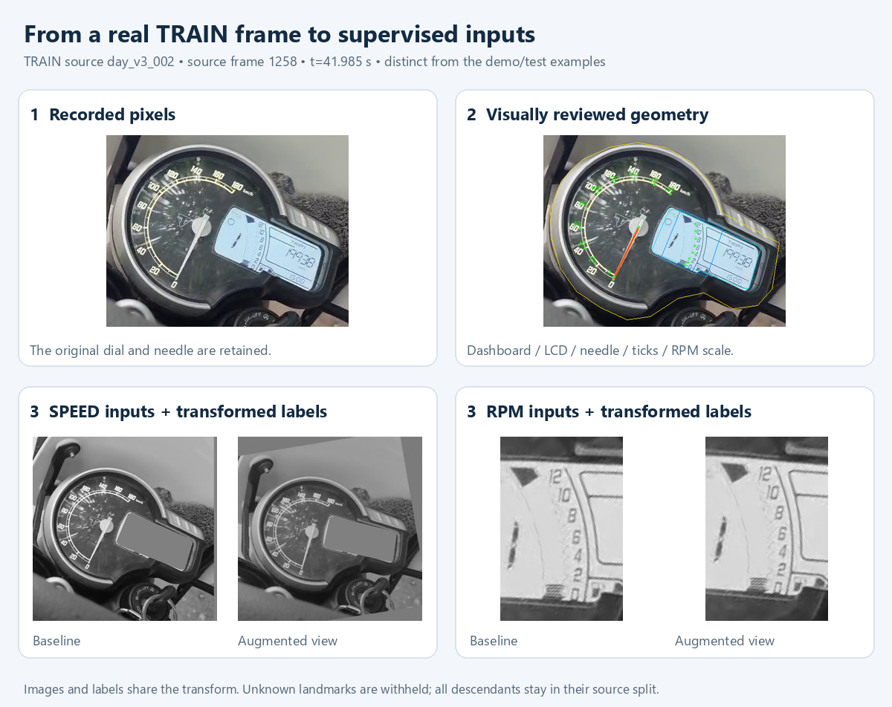

# Experiment map

The [original repository](https://github.com/sainadh812/triumph-speedometer-dataset) holds the detailed experiments. This repository contains the selected inference pipeline and a small visual record.

| Stage | Kept | Changed or rejected | Archive |
|---|---|---|---|
| First 500 synthetic images | Speed + needle labels; scripted rendering | A cleaned source cannot reproduce real glass and lighting | [Pilot](https://github.com/sainadh812/triumph-speedometer-dataset/tree/main/training_pilot) |
| Full-circle camera roll | Transform image and labels together | Roll is not an out-of-plane camera change | [Rotation](https://github.com/sainadh812/triumph-speedometer-dataset/tree/main/rotation_dataset) |
| Ring and named ticks | Needle + tick geometry | Unreliable ticks can invalidate a clear needle | [Arc/tick results](https://github.com/sainadh812/triumph-speedometer-dataset/tree/main/results/arc_ticks_augmented_v2) |
| Real night/day adaptation | Real source appearance; reviewed masks | Fixed coordinates break when framing changes | [Night](https://github.com/sainadh812/triumph-speedometer-dataset/tree/main/real_adaptation_v3), [day](https://github.com/sainadh812/triumph-speedometer-dataset/tree/main/real_adaptation_v4) |
| Mixed views | Retain both views in training | Mirrored text is not a real opposite-side view | [Mixed views](https://github.com/sainadh812/triumph-speedometer-dataset/tree/main/mixed_view_v5) |
| LCD and RPM | Learn crop regions; read scale anchors | A detected LCD does not guarantee a readable RPM bar | [LCD](https://github.com/sainadh812/triumph-speedometer-dataset/tree/main/learned_lcd_v1), [RPM pilot](https://github.com/sainadh812/triumph-speedometer-dataset/tree/main/rpm_training_v1) |
| Dashboard + two readers | One workflow, three sequential training tasks | Separate day/night metrics reveal aggregate regressions | [Joint workflow](https://github.com/sainadh812/triumph-speedometer-dataset/tree/7a3fd991d6c0e85e050e593c76fd895d59d516ed/dashboard_joint_v1) |
| Daylight fine-tuning | 22 new reviewed daylight sources; crop jitter; appearance guard | Keep baseline weights if validation does not improve | [Current evidence](results/summary.json) |

One early synthetic test reached **81/100 inputs within ±2 km/h** using geometry. It came from one reconstructed dial, not independent road recordings. The change also restored a separate needle branch, so it is not an isolated tick-model comparison.

Next useful data: independently recorded daylight sessions, readable empty RPM bars, glare/blur examples marked unreadable, and background frames without a dashboard. RGB is a future experiment; current models remain grayscale.
