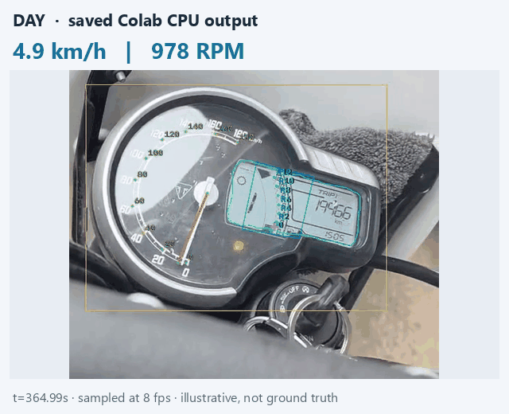
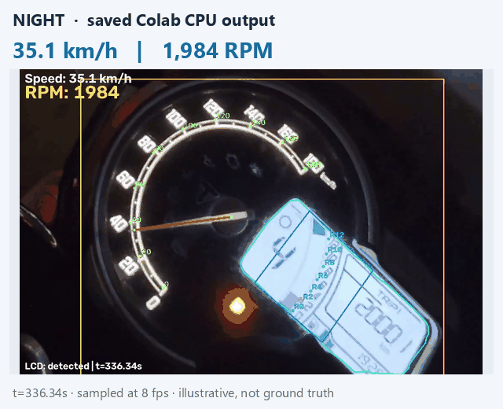
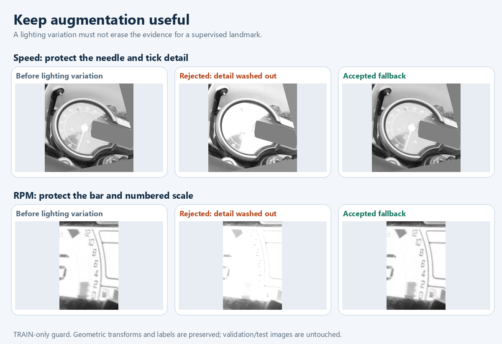

# Triumph dashboard reader

Reading the analog speedometer and LCD RPM bar on a Triumph Scrambler 400 XC. Built from a synthetic dial, then trained with reviewed daylight and night video frames.

[**Download selected weights**](https://github.com/sainadh812/triumph-dashboard-reader/releases/tag/v0.1.0) · [Experiment archive](https://github.com/sainadh812/triumph-speedometer-dataset)

## Watch the detections

Two earlier speed experiments, with the original input and prediction overlays. Press **Play** on either video.

### Startup sweep · 0 → 180 → 0

https://github.com/user-attachments/assets/69754f0d-e5bc-48b1-8273-85c016cad984

**18 seconds · V3, epoch 8.** Ignition self-test, not road speed. Cyan: predicted needle. Amber: aligned reference ticks.

### Left camera view · around 60 km/h

https://github.com/user-attachments/assets/56c0f28d-c2bb-467c-b0f4-466a1ae7727e

**12 seconds · V4, epoch 17.** Predicted needle and named ticks follow the angled dial. Original frame on the left; masked model input on the right.

These recordings were used during development. They show earlier behavior, not an independent accuracy test of the current weights. [Clip provenance](assets/historical-video-provenance.json).

More previews: recent daylight and night

| Daylight | Night |
|---|---|
|  |  |

Preview clips from the saved CPU test. GPU frame comparisons are below. Readings are estimates; glare and empty RPM bars still cause errors.

## Try a video

Open Colab → select GPU (or CPU) → run setup → upload your video → download the labeled MP4 and reports. **No Drive sign-in required.** The full frame stays visible, with needle, ticks, LCD outline and larger RPM text. Save downloads before disconnecting the runtime.

## How it works

| Model | Input | Predicts |
|---|---|---|
| Localizer | Whole frame, 512 × 512 | Dashboard, LCD mask/corners, RPM region |
| Speed | Dashboard, 512 × 512; LCD filled gray | Needle pivot/tip and named ticks |
| RPM | Rectified scale, 256 wide × 384 high | 0–12 scale anchors and bar endpoint |

Three MobileNetV3-Small models; grayscale inputs. Geometry converts landmarks into readings. A reader runs only when its region is usable. Unavailable readings keep their rejection reason in the report. Gear and odometer are not implemented.

### Arc and needle annotations

ImageGen-reconstructed source with annotations added in code. **Cyan:** scale arc · **yellow:** six visible tick anchors · **pink:** needle pivot and tip. Orange marks the needle-occluded region. This is the early labeling design, not model predictions.

## What changed along the way

| Problem | Decision | What we learned |
|---|---|---|
| Clean synthetic images looked easier than real video | Add reviewed real day/night frames | Synthetic success did not establish real-camera accuracy. |
| Needle direction alone missed camera pose | Predict named ticks as well | Geometry needs reliable anchors. |
| Fixed LCD masks covered the needle | Learn dashboard/LCD regions | Keep the speed mask precise; give RPM its own crop. |
| One camera view displaced another | Mix views and lighting; retain old validation | Rotation and mirrors do not create a new physical viewpoint. |
| Augmentation erased labeled detail | Review crops; reject destructive appearance changes | More variation is useful only while labels remain credible. |
| Fine-tuning sometimes got worse | Include starting weights in checkpoint selection | Latest speed training kept **epoch 0**. |

Latest dataset: **94 reviewed source frames → 8,864 training inputs** across three tasks. Daylight gets more sampling weight; night remains included. Labels follow geometry, and every source's variants stay in one split. Bulk synthesis uses scripts/OpenCV; early source cleanup used ImageGen. Full recordings and the current training dataset are not bundled. [Earlier experiments and generators](EXPERIMENTS.md).

## Prediction quality

Latest selected epochs: **localizer 5 · speed 0 · RPM 14**. Both GPU tests use matching frames from the same day/night recordings. Inspect the needle, named ticks and RPM endpoint; changed numbers alone do not establish better predictions.

Night and glare: matching GPU frames

**Still failing:** the empty bar produces **259 RPM** with the selected weights. The glare example is withheld by both GPU runs. We have not established an overall speed/RPM accuracy improvement.

What validation changed

Night RPM endpoint error improved; speed weights stayed unchanged. These are small validation groups from the same recordings, not an independent accuracy benchmark.

The latest GPU test processed **7,201 frames** across two two-minute windows. Availability means a reading was displayed, not that it was correct. [Metrics](results/summary.json) · [GPU frame provenance](assets/gpu-qualitative-provenance.json).

## GPU measurements

**Colab T4 · batch 16 · float16 autocast · 19 October 2026.** Selected dashboard/LCD, speed and RPM pipeline; each clip covers the last two minutes of its recording.

| Clip | Frames | Prediction FPS | Full-output FPS | Total processing time |
|---|---:|---:|---:|---:|
| Daylight · 848 × 478 | 3,602 | **52.90** | **15.34** | 234.80 s |
| Night · 1280 × 720 | 3,599 | **53.19** | **8.84** | 407.05 s |

Prediction includes input preparation, conditional model calls and geometry. Full output also includes video decoding, overlays, logging, encoding and verification; model setup and Drive transfers are excluded. These are throughput measurements, not accuracy or training-improvement claims. [Exact timings and definitions](results/summary.json).

Separate CPU and GPU measurements

Hardware timings describe execution cost. They do not show a training improvement. Compare FPS before/after only with the same hardware, clips, precision, batch size and processing steps.

