# Triumph dashboard reader

An experiment in reading a Triumph Scrambler 400 XC: from one synthetic needle to ring landmarks, LCD masking, dashboard localization and RPM scale reading. This is the research trail, including the changes that helped and the ones that broke earlier behavior.

[Selected weights](https://github.com/sainadh812/triumph-dashboard-reader/releases/tag/v0.1.0) · [Experiment notes](EXPERIMENTS.md) · [Code and dataset archive](https://github.com/sainadh812/triumph-speedometer-dataset)

## Watch the detections

Two earlier speed experiments. Press **Play** on either video.

### Startup sweep · 0 → 180 → 0

https://github.com/user-attachments/assets/69754f0d-e5bc-48b1-8273-85c016cad984

**18 seconds · V3, epoch 8.** Ignition self-test, not road speed. Cyan: predicted needle. Amber: aligned reference ticks.

### Left camera view · around 60 km/h

https://github.com/user-attachments/assets/56c0f28d-c2bb-467c-b0f4-466a1ae7727e

**12 seconds · V4, epoch 17.** Predicted needle and named ticks. Original frame on the left; masked model input on the right.

Both recordings were used during development. These are earlier models, not an independent test of the current weights. [Clip provenance](assets/historical-video-provenance.json).

## Research path

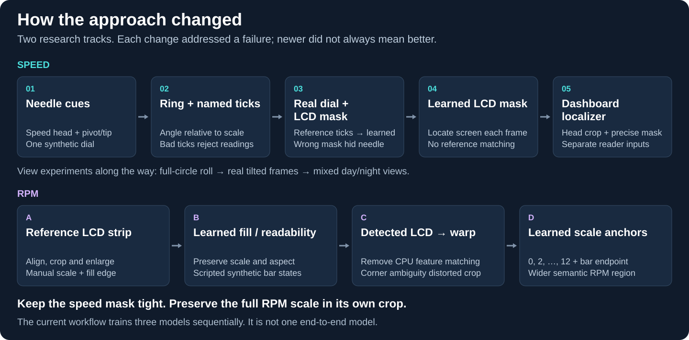

### Arc and needle annotations

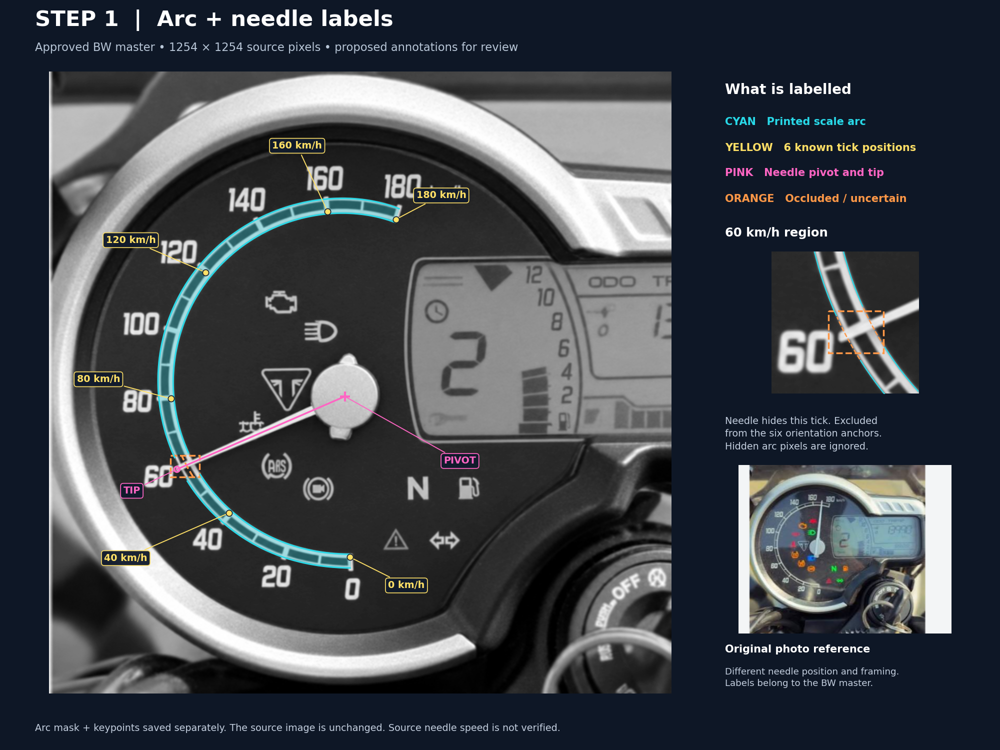

We began with **500 scripted grayscale images** from one reconstructed dial. The first network predicted speed directly, with needle pivot/tip as auxiliary targets. Ring landmarks came next: estimate the needle angle **relative to named scale positions**, rather than rely on image orientation.

This ImageGen-reconstructed source has annotations added in code: cyan arc, six visible yellow anchors, pink pivot/tip. Orange marks an occluded region. These are labels, not predictions; later versions learned ten tick positions.

### The LCD mask helped—until the camera view changed

Masking keeps changing gear/trip digits out of the analog-speed reader.

| Earlier night-view mask on the day video | Day-view data, corrected mask and learned ticks |
|---|---|
| 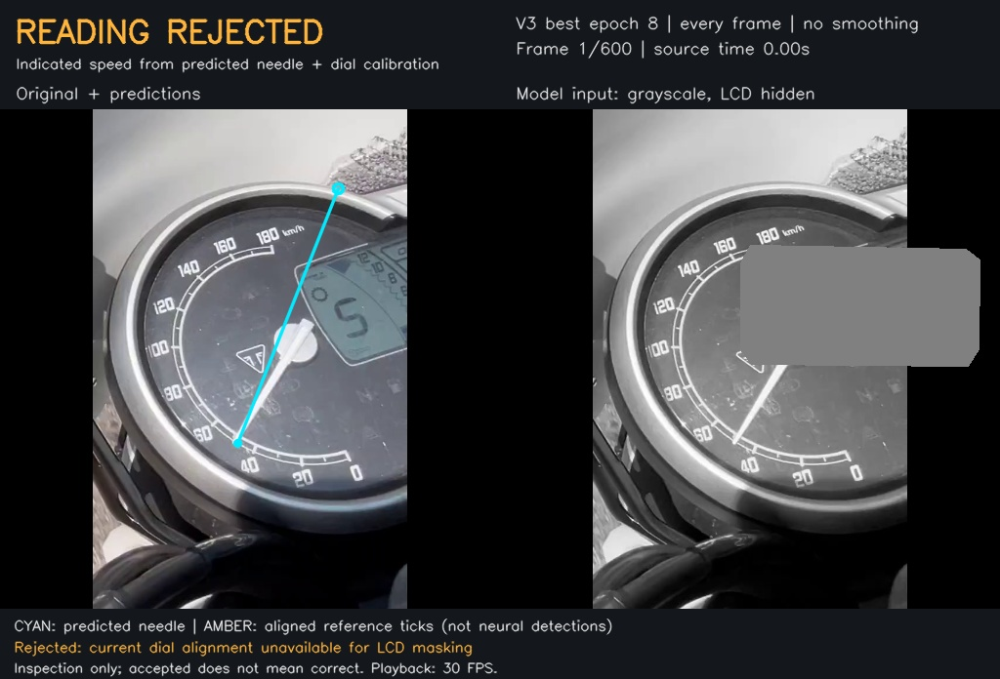 | 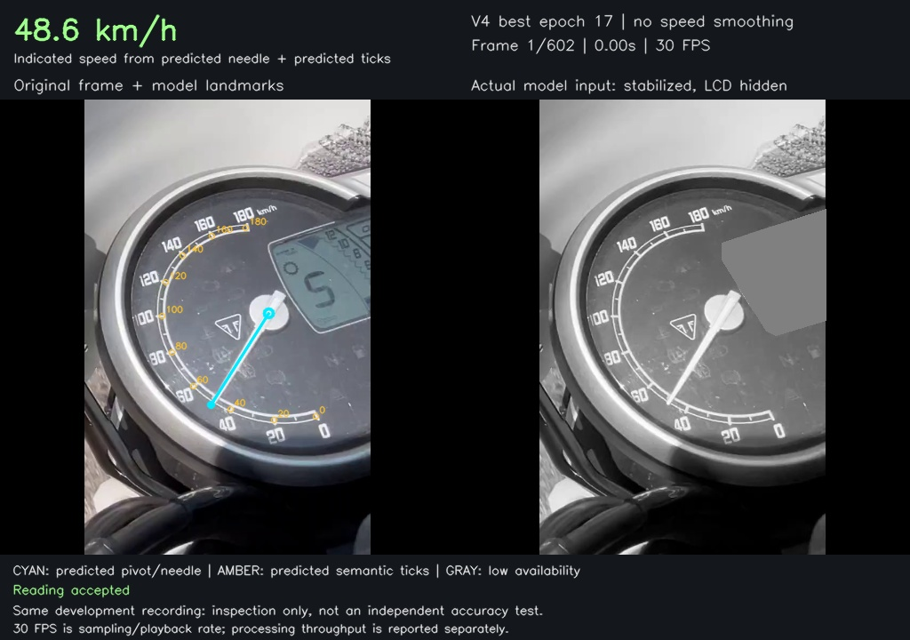 |

**Same source frame.** The old mask covered the hub. Removing it alone did not fix that model. We added actual day-view training plates, fitted the mask and trained named ticks together. This shows the combined change, not the effect of masking alone.

Next came mixed straight/tilted views, a learned LCD mask, then a **dashboard localizer** to produce the regions for both readers. Rotation augmentation helped camera roll; it could not reproduce every physical viewpoint.

### RPM: finding the screen was only the beginning

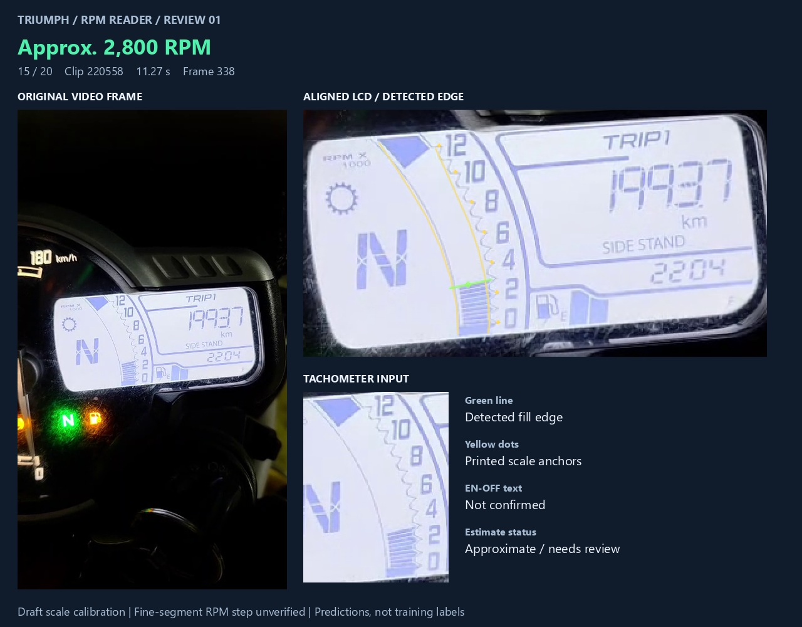

The first RPM prototype aligned the LCD to a reference, cropped and enlarged its scale, then used manually marked readings and a fill edge. The first neural reader learned **fill fraction + readability**. Later we used the detected LCD to position that crop—but a plausible LCD outline could still produce a distorted scale.

See the synthetic strip and the crop failure

Early scripted synthesis preserved the curved scale and excluded gear/trip text. The displayed synthetic RPM is a draft target, not measured engine RPM.

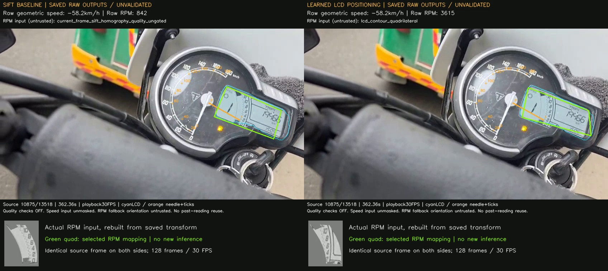

The detected-LCD warp clipped part of the scale and admitted the display border. Both displayed readings are **unvalidated raw outputs** from a diagnostic with checks disabled; neither is ground truth. Enlarging the wrong crop did not fix its contents.

The current design learns corresponding LCD corners and a **separate, wider RPM region**, then predicts **0, 2, 4, …, 12 scale anchors and the bar endpoint**. These are named landmarks, not digit OCR. The speed mask stays tight while the RPM crop preserves scale context.

[Stage-by-stage decisions and evidence](EXPERIMENTS.md) · [Image sources and hashes](assets/research-provenance.json)

## Current pipeline

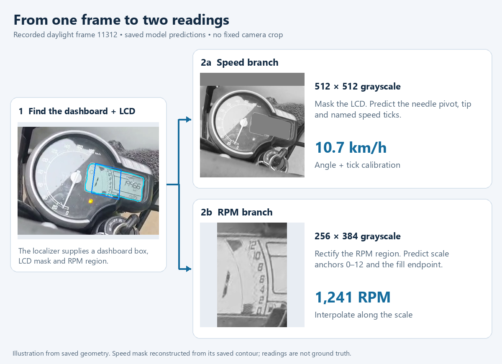

| Model | Input | Predicts |
|---|---|---|
| Localizer | Whole frame, 512 × 512 | Dashboard, LCD mask/corners, RPM region |
| Speed | Dashboard, 512 × 512; LCD filled gray | Needle pivot/tip and named ticks |
| RPM | Rectified scale, 256 wide × 384 high | 0–12 scale anchors and bar endpoint |

Three MobileNetV3-Small models trained sequentially in one workflow. Inputs remain grayscale; geometry converts landmarks to readings. Gear and odometer are not implemented.

Latest data: **94 reviewed source frames → 8,864 task-specific training inputs**. Daylight is sampled more often while retaining night data. Each source's variants stay in one split. Bulk synthesis uses scripts/OpenCV; early source cleanup used ImageGen. [Data decisions](EXPERIMENTS.md#data-and-training-decisions).

## A later version regressed on the startup video

| Earlier V3: predicted needle + reference ticks | Current: learned localizer + learned ticks |
|---|---|
| 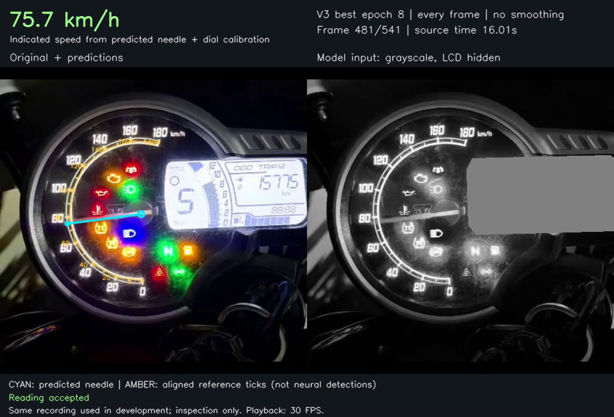 | 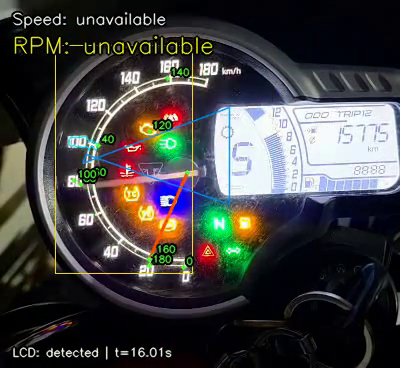 |

**Same recording, frame 480.** This is a failure example across different pipelines, not an isolated training or hardware comparison. The earlier displayed number is not ground truth.

Across **541 frames**, the current run detected LCD in **528**, displayed speed in **272**, and displayed RPM in **54**. On **457 frames**, invalid RPM-region geometry prevented the RPM reader from running. A visible LCD did not guarantee a usable crop. Availability is not accuracy. [Counts and timings](results/startup-regression.json).

The next checkpoint-selection rule should include fixed old-view clips, separate day/night results and the **complete pipeline**, including crops. Better results on a new view must not hide a regression on an old one.

Other current results: matching GPU frames and remaining errors

Selected epochs: **localizer 5 · speed 0 · RPM 14**. Speed kept its starting weights because fine-tuning did not improve validation.

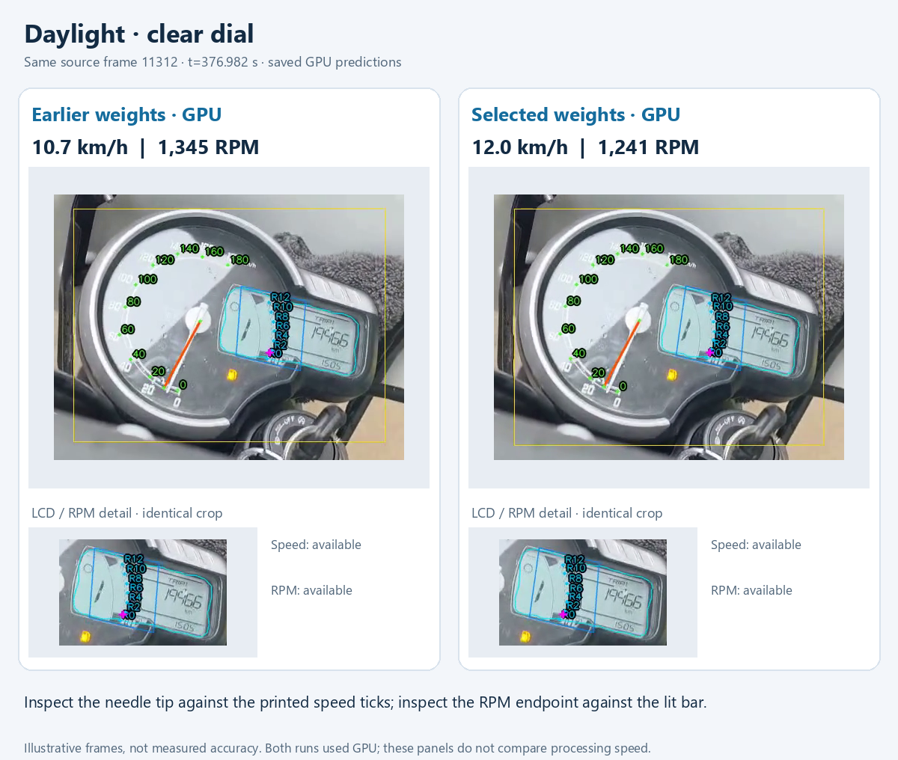

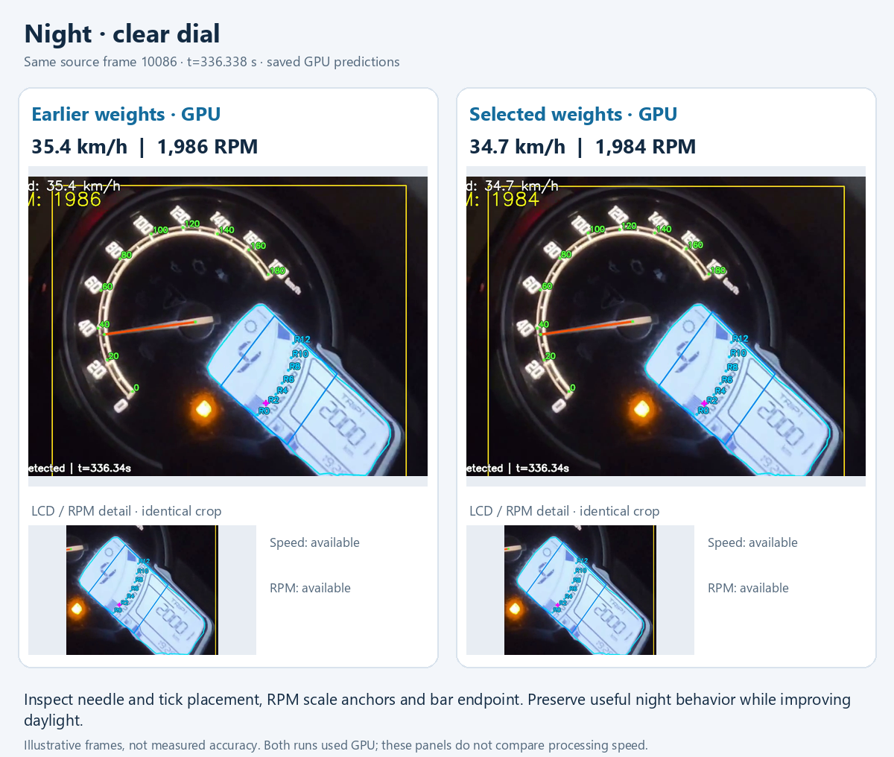

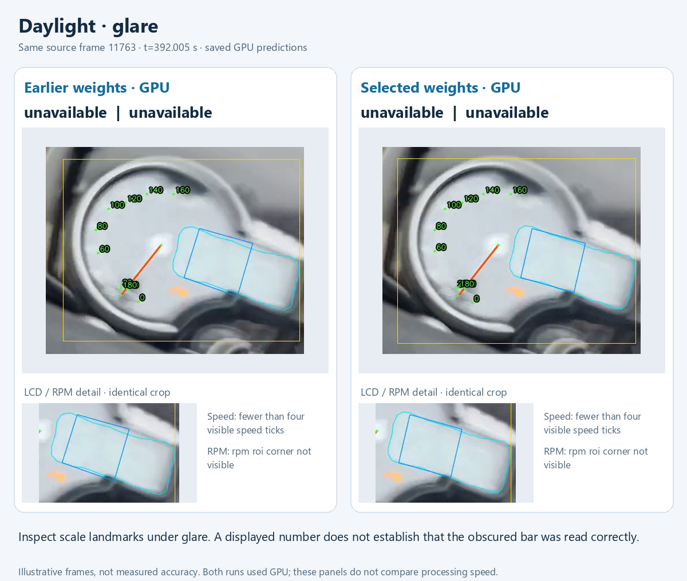

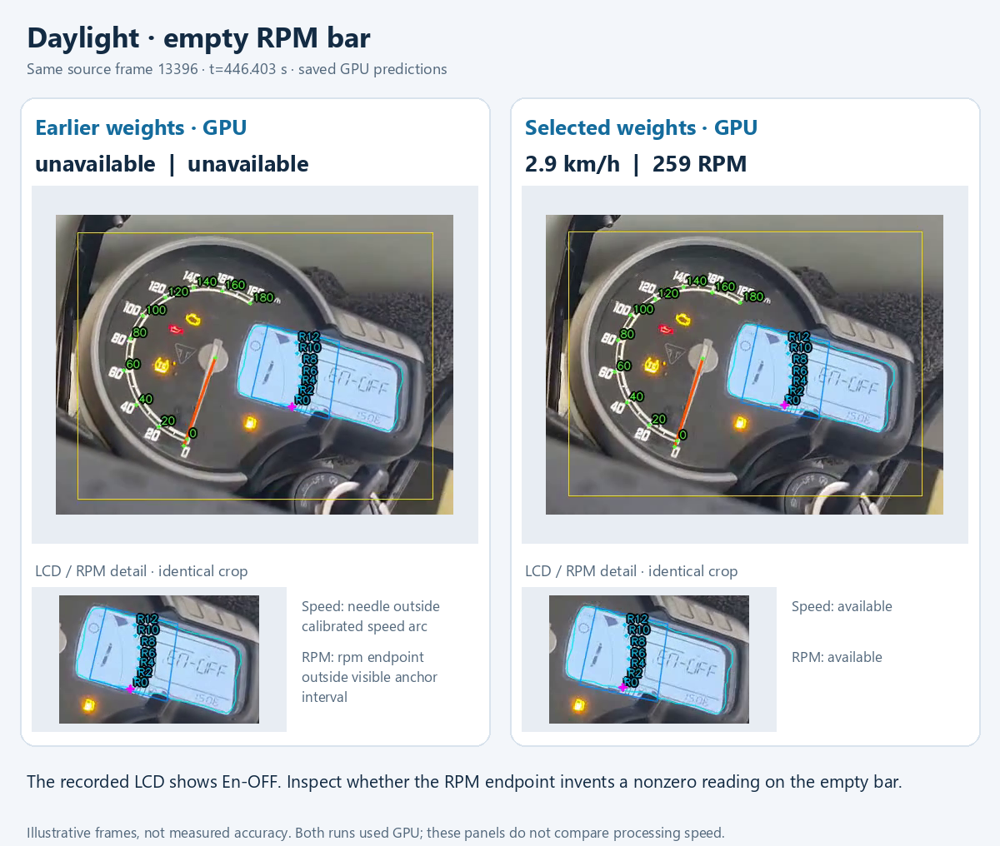

The empty bar still produces **259 RPM**. We have not established an overall speed/RPM accuracy improvement.

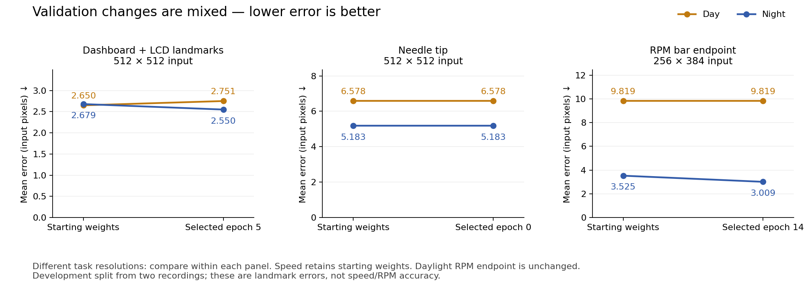

Night RPM endpoint validation improved; these small groups share source recordings with development. [Metrics](results/summary.json) · [GPU frame provenance](assets/gpu-qualitative-provenance.json).

## Try a video

Open Colab → select GPU or CPU → run setup → upload your video → download the labeled MP4 and reports. **No Drive sign-in required.** The full frame stays visible, with needle, ticks, LCD outline and larger RPM text. These are experimental weights; inspect the output. Save downloads before disconnecting.

## GPU measurements

**Colab T4 · batch 16 · float16 autocast · 19 October 2026.** Day/night clips cover their recordings' last two minutes; startup covers the full short clip.

| Clip | Frames | Prediction FPS | Full-output FPS | Processing time |
|---|---:|---:|---:|---:|
| Daylight · 848 × 478 | 3,602 | **52.90** | **15.34** | 234.80 s |
| Night · 1280 × 720 | 3,599 | **53.19** | **8.84** | 407.05 s |
| Startup · 400 × 368 | 541 | **35.78** | **20.66** | 26.19 s |

Prediction includes preparation, conditional model calls and geometry. Full output adds decoding, overlays, logging, encoding and verification; setup and Drive transfers are excluded. RPM ran on only **84/541** startup frames. These are measured pipeline workloads, not three models forced on every frame or accuracy claims. [Day/night timings](results/summary.json) · [Startup timings](results/startup-regression.json).

Separate CPU and GPU measurements

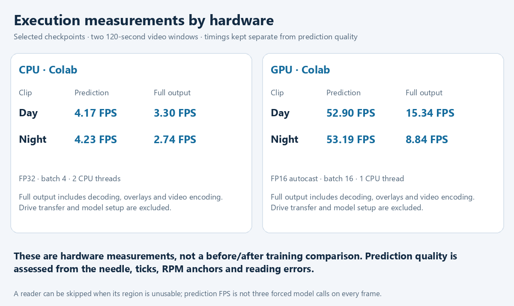

Hardware timings describe execution cost, not a training improvement. Compare FPS before/after only with matching hardware, clips, precision, batch size and processing steps.

